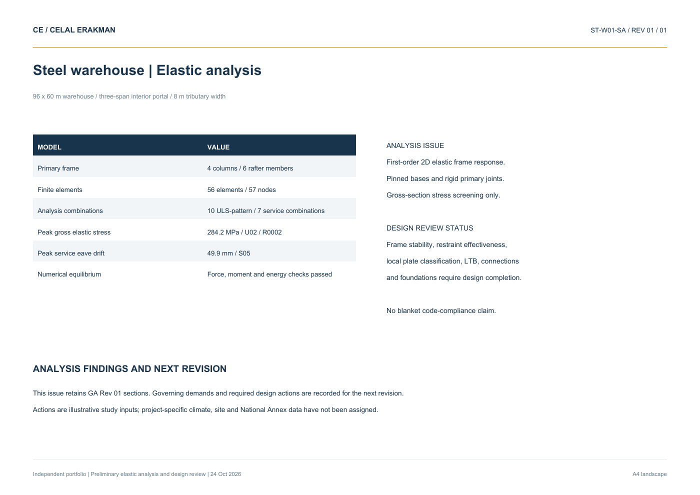
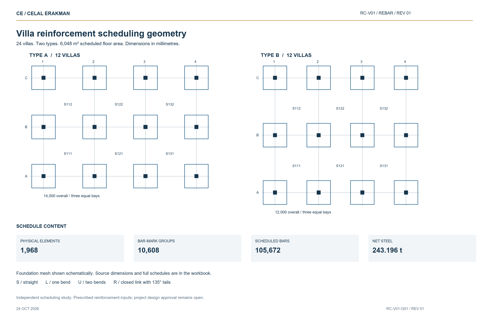
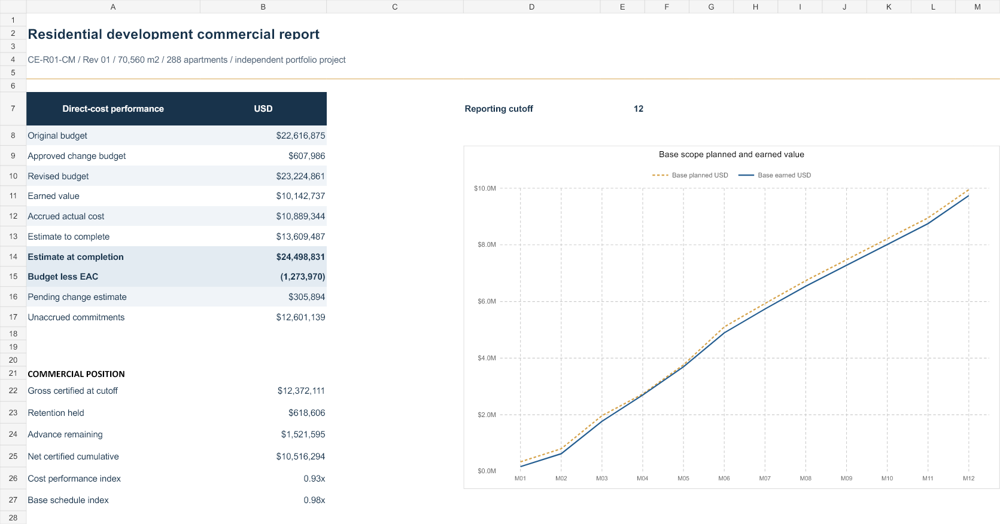
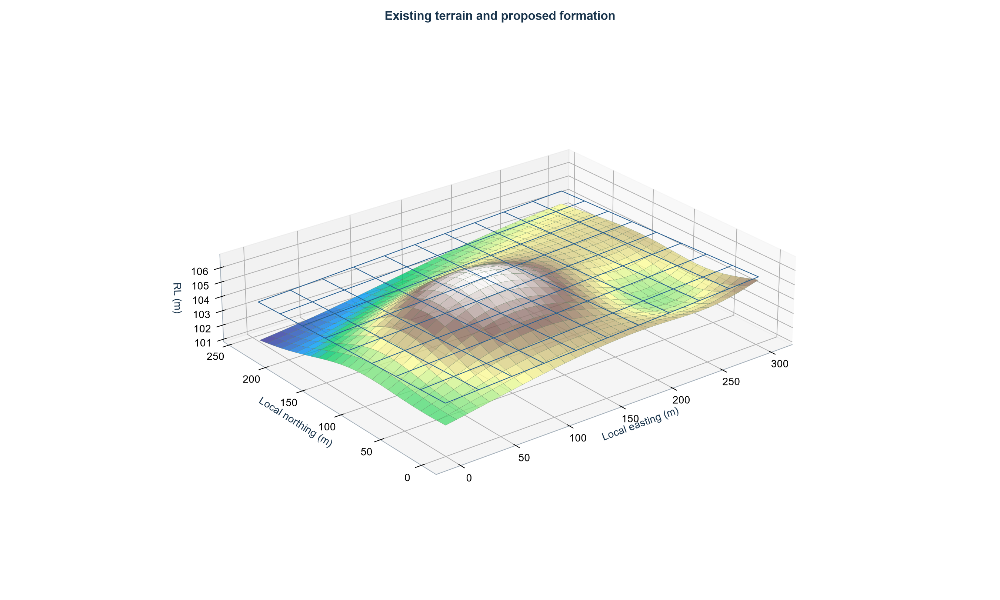

# Civil Engineering Portfolio

Quantity takeoff, cost planning and project controls by Celal Erakman.

## Residential development — CE-R01

Six residential blocks, 288 apartments and a common basement. Gross floor area: 70,560 m².

| Workbook | Contents |
|---|---|
| [Quantity takeoff and BOQ](CE_R01_Residential_Quantity_BOQ.xlsx) | 11 worksheets, 1,835 measurement records, 1,022 reinforcement groups, net BOQ, unit rates, procurement quantities and reconciliation checks. |
| [Cost, cashflow and funding](CE_R01_Cost_Cashflow_Funding.xlsx) | 11 worksheets, 32 work packages, 24-month delivery and 32-month cash horizon. Advance recovery, retention releases, collection lags, supplier payments, revolving debt and interest. |
| [Programme and project controls](CE_R01_Programme_Project_Controls.xlsx) | 12 worksheets, 809 activities and 972 logic links. Critical path, float, 106-week Gantt, workforce demand, milestones and direct-cost loading. |

### Quantity and cost report

### Cash and funding plan

### Programme and project controls

## Steel warehouse - ST-W01

96 x 60 m, three 20 m spans, 774 marked pieces and 289.566 t net theoretical steel.

[Complete CAD package](ST_W01_Steel_Model_GA_Package.zip) includes the IFC4 model, 3D DXF with eight GA layouts, GLB, eight A1 PDF sheets, piece/section registers and validation results.

## Steel warehouse - structural analysis

[Elastic analysis package](ST_W01_Elastic_Analysis_Package.zip): 15-page report, 17 load combinations, 56 frame elements and 16,184 result stations. Equilibrium, closed-form beam/column benchmarks and mesh refinement checks are included. The review identifies section stress, sway and stability items requiring a subsequent design revision.

## Villa development - reinforcement scheduling

[Reinforcement package](RC_V01_Reinforcement_Package.zip) and [editable workbook](RC_V01_Reinforcement_BBS.xlsx): 24 villas, 6,048 m2, 10,608 bar-mark groups and 243.196 t net scheduled steel. Nine sheets connect geometry, bending/cutting lengths, quantities, procurement and pour releases. Source geometry and independent verification accompany the workbook.

## Residential development - commercial control

[Commercial control workbook](CE_R01_Commercial_Control.xlsx) and [complete package](CE_R01_Commercial_Control_Package.zip): 11 sheets, 384 measurement records, 408 accrued costs, 24 variations and 64 purchasing commitments. CVR, earned value, ETC/EAC, approval status and 12 interim payment certificates with capped retention and advance recovery. 2,338 formulas, five filterable tables and a native chart. Independent input-change and arithmetic checks included.

## Site platform - IN-E01 earthworks

[Earthworks package](IN_E01_Earthworks_Package.zip) includes a layered 3D DXF, existing and formation OBJ meshes, a 12-sheet A3 drawing set, seven cross sections and CSV surface/triangle records. The 72,000 m2 platform uses 775 vertices and 1,440 triangles per surface. Formation cut: 16,407.254 m3 bank. Fill: 60,826.588 m3 compacted. Topsoil: 14,400 m3. Cut/fill triangles are clipped at the zero line and independently checked by 1 m integration. Constructed portfolio terrain, not a surveyed site.

## Working with the files

Download the Excel workbooks and open them in Microsoft Excel. Editable assumptions and calculation conventions are recorded inside each workbook. Formula checks and control totals are visible on the Checks worksheets.

The cash model uses the BOQ baseline without external workbook links. It distinguishes earned value, certified payments and cash collections.

The programme uses the same direct BOQ budget with a detailed activity network. Its time loading is a separate baseline from the aggregate cashflow phasing. Weekly workforce demand is shown before resource levelling.

Independent portfolio projects. Concept geometry, preliminary reinforcement quantities and indicative rates are documented. These files are not commissioned client deliverables or issued-for-construction designs.

