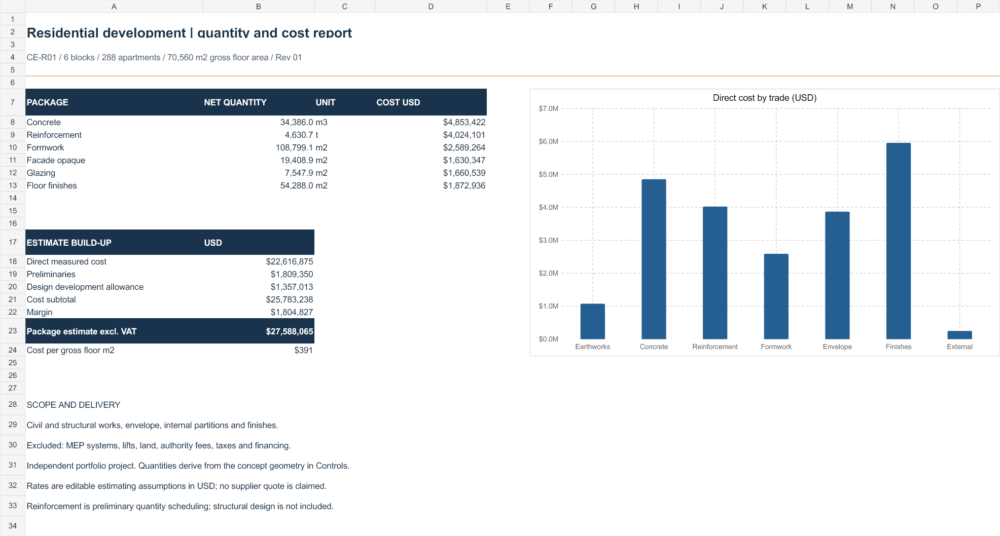
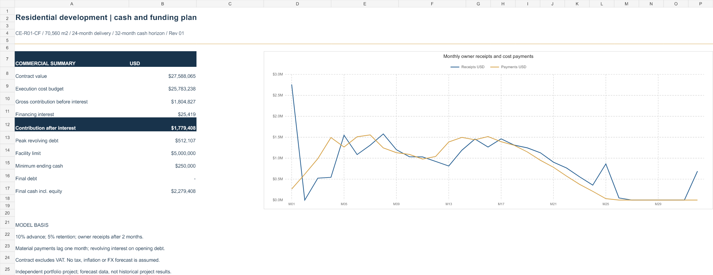

# Civil Engineering Portfolio

Quantity takeoff, cost planning and project controls by Celal Erakman.

## Residential development — CE-R01

Six residential blocks, 288 apartments and a common basement. Gross floor area: 70,560 m².

| Workbook | Contents |
|---|---|
| [Quantity takeoff and BOQ](CE_R01_Residential_Quantity_BOQ.xlsx) | 11 worksheets, 1,835 measurement records, 1,022 reinforcement groups, net BOQ, unit rates, procurement quantities and reconciliation checks. |
| [Cost, cashflow and funding](CE_R01_Cost_Cashflow_Funding.xlsx) | 11 worksheets, 32 work packages, 24-month delivery and 32-month cash horizon. Advance recovery, retention releases, collection lags, supplier payments, revolving debt and interest. |

### Quantity and cost report

### Cash and funding plan

## Working with the files

Download the Excel workbooks and open them in Microsoft Excel. Editable assumptions and calculation conventions are recorded inside each workbook. Formula checks and control totals are visible on the Checks worksheets.

The cash model uses the BOQ baseline without external workbook links. It distinguishes earned value, certified payments and cash collections.

Independent portfolio projects. Concept geometry, preliminary reinforcement quantities and indicative rates are documented. These files are not commissioned client deliverables or issued-for-construction designs.
